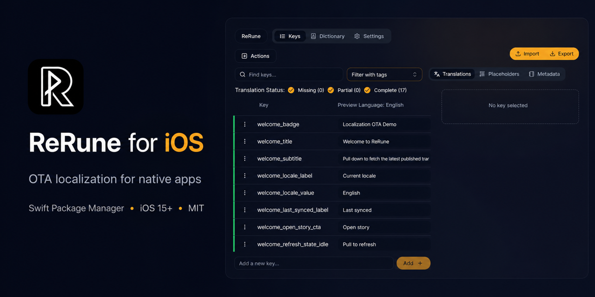

# ReRune for iOS

ReRune is an over-the-air localization SDK for iOS. Ship translation updates
and dashboard-managed app languages without waiting for another App Store
release, while keeping native `NSLocalizedString` and SwiftUI integration.

[Start for free](https://rerune.io/register) ·
[Website](https://rerune.io) ·
[Releases](https://github.com/BasalBit/rerune-ios/releases)




## Why ReRune?

- **Release-independent copy:** publish approved translation updates without
  waiting for another App Store release.
- **Runtime language expansion:** add dashboard-managed app languages after the
  application has shipped.
- **Native integration:** keep `NSLocalizedString`, UIKit, and SwiftUI revision
  observation instead of replacing the application's localization layer.

`ReRune dashboard → OTA publish → ReRune iOS SDK → native app localization`

## Install (SPM)

Requires iOS 15 or later.

Add this package dependency in Xcode:

```text
https://github.com/BasalBit/rerune-ios.git
```

Then import:

```swift
import ReRune
```

## Remote languages without an app release

ReRune can make dashboard-only languages available even when the app bundle shipped with only English resources. For example, if the app has only `en` bundled strings and the ReRune dashboard later publishes German (`de`), the SDK fetches the German manifest entry and locale payload in the background, caches it, and exposes `de` through `reRuneAvailableLocales`.

When German is selected with `reRuneSetLocale("de")`, or when iOS picks German for the user's preferred languages (see below), `NSLocalizedString(...)` calls can render the dashboard-delivered German strings after the first successful fetch. On the next launch, `reRuneSetup(...)` restores the cached manifest and German strings before the UI is shown (for a selection, when the app passes it to `reRuneSetLocale` again before setup, see "Setup requirements"), so the same language can render immediately without a compiled `de.lproj`.

ReRune picks the language the way iOS picks a localization for your app, and adds ReRune's values on top. iOS chooses from the app's bundled languages, its development language, and the languages ReRune has saved from the dashboard, trying every language in the phone's list in order, or the language passed to `reRuneSetLocale`. The manifest's `main_language` and its fallbacks come last. At each language, the ReRune value comes before the app's bundled string, and a missing key goes on to the next language. For example:

- A `de-AT` phone in an app with `de-AT`, `de`, and main language `en`: ReRune `de-AT`, bundled `de-AT`, ReRune `de`, bundled `de`, ReRune `en`, bundled `en`.
- A Taiwan phone (`zh-Hant-TW`) in an app with `zh-TW` and `zh-Hant` strings: `zh-TW`, then `zh-Hant`, then the main language. Plain `zh` is Simplified Chinese for iOS and is never used for a Traditional Chinese phone. A bundled `zh-TW` comes before a dashboard `zh-Hant` here, because iOS ranks `zh-TW` first.
- An app that ships only English, with Italian published on the dashboard: once Italian is saved, a phone set to Italian, or to French and then Italian, shows the dashboard's Italian. A phone set only to French shows the app's development language, English, as iOS does; when the development language and the main language differ, the development language comes first.

The backend owns the main language fallback; applications do not need another setup parameter. Cached manifests and saved languages restore the same order synchronously on later launches. An update check that saves a language that fits the phone better switches to it and sends one refresh through `reRuneRevisionPublisher`.

This runtime language expansion is app-level. iOS Settings language lists, App Store language metadata, native system strings, and new string keys still require an app release.

## Setup requirements

Call `reRuneSetup(...)` at launch, before the app shows ReRune strings, with
an `otaPublishId` that, after trimming whitespace and newlines, is neither
empty nor `.` nor `..`. An ID that is empty, `.`, or `..` stops the app at
the `reRuneSetup` call, so a misconfigured build fails visibly instead of
running without updates. The Swift fatal error names the problem in every
build configuration, including the released binary:

- an empty or blank ID (only whitespace and newlines, including Unicode
  spaces such as U+00A0 and the zero width space U+200B):
  `ReRune/ReRune.swift:48: Fatal error: reRuneSetup requires a non-empty otaPublishId.`
- an ID of `.` or `..`:
  `ReRune/ReRune.swift:48: Fatal error: reRuneSetup requires an otaPublishId that is not "." or "..".`

Before 1.6.0 the message was printed only by builds without optimization.

Other invalid setup values do not stop the app. ReRune logs an error from
the `.error` log level, writes it to the system log even with
`logLevel: .off` (see "Logging"), and continues with a corrected value:

- a negative `periodicIntervalInHours` or `periodicIntervalInDays` counts as
  `0`, and a periodic interval longer than 366 days counts as 366 days;
- a `requestTimeout` that is not a finite number of at least 0.001 seconds
  counts as 10 seconds, and one longer than 60 seconds counts as 60 seconds
  (URLSession's own default request timeout);
- an invalid variant slug selects Main (see "Translation variants");
- a tag passed to `reRuneSetLocale` before the first `reRuneSetup` that is
  not a valid locale identifier uses the device language (see below).

A later `reRuneSetup(...)` call replaces the earlier setup.

To start in a language the user chose earlier, call `reRuneSetLocale(_:)`
with it right before `reRuneSetup(...)`. Setup keeps a language selected
before the first `reRuneSetup(...)` call and loads only that language and
its fallbacks at launch:

```swift
reRuneSetLocale(UserDefaults.standard.string(forKey: "selectedLocale"))
reRuneSetup(otaPublishId: "replace-with-ota-publish-id")
```

`nil`, or no call, follows the device language. A tag that is not a valid
locale identifier also uses the device language, and setup logs it once:
`reRuneSetLocale: the locale selected before reRuneSetup is not a valid locale identifier, so setup uses the device language.`
ReRune does not save the selection. A language selected before the first
`reRuneSetup(...)` call lasts for that first session only: every later
`reRuneSetup(...)` call clears any selected language, that one too. A
language selected after the first setup lasts until the next
`reRuneSetup(...)` call, which clears it even when it was selected right
before that call, so an app that calls `reRuneSetup(...)` again and wants
to keep the language calls `reRuneSetLocale(_:)` with it after that setup.

Before `reRuneSetup(...)`, lookups return the app's shipped strings,
`reRuneCheckForUpdates()` returns `.failed`, and `reRuneSetVariant`,
`reRuneResetVariant`, and `reRuneSetStagingMode` throw `setupRequired`.

## UIKit quick start

```swift
import ReRune

reRuneSetup(otaPublishId: "replace-with-ota-publish-id")

titleLabel.text = NSLocalizedString("title", comment: "")

reRuneRevisionPublisher
    .dropFirst()
    .sink { [weak self] _ in self?.rebindStrings() }
    .store(in: &cancellables)
```

Rebinding on `reRuneRevisionPublisher` is the supported UIKit pattern on every
iOS version. On iOS 26, UIKit also refreshes strings that you look up in
`viewWillLayoutSubviews`, because it tracks the lookup like an observed value.

## SwiftUI quick start

```swift
import SwiftUI
import ReRune

@main
struct ExampleApp: App {
    init() {
        reRuneSetup(otaPublishId: "replace-with-ota-publish-id")
    }

    var body: some Scene {
        WindowGroup {
            ContentView()
        }
    }
}
```

```swift
import SwiftUI

struct ContentView: View {
    var body: some View {
        Text("title")
    }
}
```

`Text("key")` shows ReRune values with no code changes, including Markdown.
Views that take a key directly, such as `Button("key")`,
`Label`, `Toggle`, and `navigationTitle`, behave the same way. SwiftUI
resolves these strings when it creates the view: screens opened after an
update show the new values, while a view already on screen can keep its
previous value until SwiftUI creates it again, for example on the next launch.

For a string that must update while its screen is visible on iOS 17 and
later, look it up in `body`:

```swift
Text(NSLocalizedString("title", comment: ""))
```

On iOS 17 and later, views that look up strings in their `body` refresh
automatically when ReRune applies new translations. Strings resolved outside
`body`, for example in an initializer or a view model, do not.

A `Text("key")`, or a view that takes a key, inside
`.environment(\.locale, ...)` with a locale other than the device's current
locale shows the app's shipped strings for that locale, because SwiftUI then
reads the app's string files itself. This was observed with a `de` locale on
an English device; a locale that differs only in its region is expected to
behave the same. A string looked up with `NSLocalizedString` and passed to
`Text` is not affected. To change the app's language, use
`reRuneSetLocale(_:)` and leave the environment locale of those views at the
default.

### Keys and arguments

The key of a remote string must equal the key your app looks up, character
for character. The ReRune dashboard delivers keys shared with Android, such
as `welcome_key`.

- For a string without arguments, use `Text("key")`, which looks up the key
  as written.
- For a string with arguments, look the string up by its key and format it:

```swift
Text(String(format: NSLocalizedString("welcome_key", comment: ""), name))
```

- For a plural, format it with `String.localizedStringWithFormat` (see
  "Plural strings"):

```swift
Text(String.localizedStringWithFormat(NSLocalizedString("item_count", comment: ""), count))
```

An interpolated `Text` looks up the key Swift generates from it, which is
the key your String Catalog shows: `Text("\(count) keys")` looks up
`%lld keys`, and `Text("Welcome \(name)")` looks up `Welcome %@`. It shows a
ReRune value only when the dashboard has a key spelled exactly that way,
including a plural for `%lld keys`. A dashboard key such as `keys_count`
does not reach it, and the view shows your app's shipped string.

Ship a value for every key you format with arguments, at least in your
development language. ReRune checks a remote value that reads arguments
against the value your app ships for the key, so a dashboard edit cannot make
your `String(format:)` call read arguments it does not pass. For a key your
app does not ship in any language, and whose name has no format directive
(such as `welcome_key`), there is nothing to check against. Its remote value
with arguments is then used only when the lookup passes a default value with
a matching format:

```swift
NSLocalizedString("welcome_key", value: "Welcome %@", comment: "")
```

Otherwise ReRune skips that remote value, logs a warning, and the lookup
continues as if it did not exist, so `NSLocalizedString("welcome_key",
comment: "")` returns `welcome_key`. To keep remote values for such keys, add
their development language values to your app, for example with
`rerune pull`, or pass the format as the default value. Remote values without
arguments need neither.

Every remote placeholder such as `{{name}}` needs a declaration. When your
app ships the key, the declared type must also match the shipped format:
`string` for `%@`, `int` for `%lld`. Otherwise ReRune does not apply that
locale update: the locale keeps its previously applied values, or lookup
continues with the next step of the lookup order.

### iOS 15 and 16 only: `reRuneObserveRevision()`

Apps that support iOS 15 or 16 apply `reRuneObserveRevision()` once near the
root of the screens that show ReRune strings. On those versions it rebuilds
that subtree when translations change, which also resets its view state, such
as scroll positions and text input. It has no effect on iOS 17 and later,
where views that look up strings in `body` refresh automatically, and it is
deprecated there, so apps with a minimum of iOS 17 do not need it.

```swift
WindowGroup {
    ContentView()
        .reRuneObserveRevision()
}
```

## Logging

SDK diagnostics are disabled by default. Opt in during setup only when needed:

```swift
reRuneSetup(
    otaPublishId: "replace-with-ota-publish-id",
    logLevel: .info
)
```

| Level | Behavior |
| --- | --- |
| `.off` | Default. Prints no SDK diagnostics. Errors and warnings still reach the system log (see below). |
| `.error` | High-level failures and warnings about rejected remote values, without causes or sensitive request/response details. |
| `.info` | Adds operation names, sanitized request method/URL, synchronization decisions, and response status codes. |
| `.verbose` | Adds full request URLs, headers, bodies, failure causes, and stack traces. |

Levels are cumulative and every message starts with `ReRune:`. Use `.verbose` only as an explicit sensitive-data diagnostic mode: it may expose credentials and translation content. Headers, bodies, credentials, causes, and stack traces are never logged below `.verbose`. The OTA publish ID is not a secret: from `.info`, logged request URLs show it as part of the URL path. The `errorMessage` of a failed update check can show it too, inside a request URL.

Whatever the log level, ReRune also writes its errors, warnings, and safety
events to the unified system log under the subsystem `io.rerune.sdk`
(categories `setup`, `runtime`, and `safety`), so Console shows them with
logging off. Each distinct message is written once per process, at most 256
per category. These messages name locales, versions, keys, and class names,
never translation values or the publish ID.

When ReRune rejects a locale because of an incompatible remote value, it logs one warning per key and one for the locale from `.error`:

```text
ReRune: Warning: Locale de rejected the remote value for key "items_count" because it reads format arguments that the value shipped in the app does not pass.
ReRune: Warning: Locale de was not applied because 1 remote value is incompatible. Lookup keeps the previously applied values for this locale, or falls back to the next available value.
```

When ReRune leaves out a single remote value and applies the rest of the
locale, it logs one warning for that key and locale, for example:

```text
ReRune: Warning: Locale de skipped the remote value for key "welcome_key" because the app ships no value for the key, so ReRune cannot verify the format arguments of the call site. Lookup uses the next available value. Ship a value for the key in the app, or pass the expected format as the lookup's default value.
```

## Privacy

ReRune ships a privacy manifest (`PrivacyInfo.xcprivacy`) in the Swift
package and in every XCFramework slice. It declares no tracking, no tracking
domains, no collected data, and no required reason APIs. ReRune's cache in
Application Support is excluded from iCloud and computer backups, except
the Variant selection saved with `reRuneSetVariant(persist: true)`, which
stays in backups, so a restore keeps it. After a restore, the app shows its
own strings, with the saved Variant selection, until the next update check
downloads the manifest and the languages again. The first launch with
ReRune 1.6.0 moves the cache files that 1.5.0 wrote into the excluded
folder, so nothing downloads again.

## Runtime language picker

After setup, apps can show the union of compiled bundle locales and ReRune dashboard locales:

```swift
let locales = reRuneAvailableLocales
let localeDetails = reRuneAvailableLocaleDetails
```

`reRuneAvailableLocalesPublisher` emits identifier-list changes.
`reRuneAvailableLocaleDetailsPublisher` also emits manifest display-name
changes. To switch the SDK runtime language from an in-app picker:

```swift
reRuneSetLocale("de")
```

Pass `nil` to follow the system preferred language again:

```swift
reRuneSetLocale(nil)
```

The current app-level override is available as `reRuneSelectedLocale`. ReRune does not save it. Persist picker choices in app storage and pass them to `reRuneSetLocale(_:)` right before `reRuneSetup(...)` if the selected language should survive app restarts; setup then starts in that language and loads only its languages at launch, where calling `reRuneSetLocale(_:)` after setup first loads the device language.

For example:

```swift
private let localeStorageKey = "selectedLocale"

func configureLocalization() {
    reRuneSetLocale(UserDefaults.standard.string(forKey: localeStorageKey))
    reRuneSetup(otaPublishId: "replace-with-ota-publish-id")
}

func selectLocale(_ locale: String?) {
    UserDefaults.standard.set(locale, forKey: localeStorageKey)
    reRuneSetLocale(locale)
}
```

How languages load: update checks download and save every published
language, so a switch also works offline, but ReRune keeps in memory only
the saved languages of the lookup order (see "Remote languages without an
app release"), for example `de-AT`, `de`, then the main language, or for
a Hong Kong phone (`zh-Hant-HK`) in an app with `zh-HK`, `zh-TW`, and
`zh-Hant` those three, then the main language. Further languages in the
phone's list add none, because iOS picks one localization for the list.
Launch time and memory therefore do not grow with the number of saved
languages. `reRuneSetLocale(_:)` loads the new language from its
saved copy on the calling thread before it returns (on a Mac about 0.1 s for
2,000 keys and 0.4 s for 10,000 keys) and unloads the languages the app no
longer uses, so switching back loads them again. A call that races a
`reRuneSetup(...)` call on another thread can return before the language
loads: the first lookup then loads it, or the app's bundled text or the
next language of the lookup order shows until a background load sends one
refresh through `reRuneRevisionPublisher`. A memory warning also unloads
every language outside the lookup order. ReRune keeps its reference to the
string bundle it wrote for SwiftUI `Text` of a language that left the order
until the next `reRuneSetup(...)` call, also after a memory warning, and
Foundation keeps every such bundle until the app process ends (see the
string files under "Notes"). A saved
language whose
copy turns out unusable when it first loads leaves
`reRuneAvailableLocales`, and the next update check downloads it again. A
saved language that turns out unusable or has no values also leaves the
lookup order, and the next language iOS matches is used; at setup and at
`reRuneSetLocale(_:)` this happens before anything is shown.

The picker can render `reRuneAvailableLocaleDetails`; each `ReRuneLocale`
contains an `identifier` and nullable manifest-provided `name`. Compiled-only
locales use their identifier as the name. The existing
`reRuneAvailableLocales` API remains available when only identifiers are needed.

```swift
ForEach(reRuneAvailableLocaleDetails, id: \.identifier) { locale in
    Text(locale.name ?? locale.identifier)
}
```

After a dashboard-only locale is successfully applied, both lists can include
it even when it was not compiled into the app bundle.

## Translation variants

Use [Translation Variants](https://rerune.io/translation-variants) when the same
product action needs different wording for a customer, white-label brand, plan,
role, region, experiment, or partner. The app keeps one translation key. Main
holds the shared content, and each named Variant overrides only the keys and
languages that differ.

Variants solve an audience problem. Use locales for language differences and
plural forms for quantity-dependent grammar. A Variant can contain plain or
supported plural content, and a missing Variant value falls back to Main for
the same key and language. An empty Variant value counts as no translation in
that language: lookup goes on as for a key without a remote value there, to
the app's bundled string for that language, then to the next language of the
fallback chain, and finally to the app's shipped string.

Each project Variant has a stable runtime value. Select one during setup when
the audience is already known:

```swift
reRuneSetup(
    otaPublishId: "replace-with-ota-publish-id",
    variant: ReRuneVariant("customer_acme")
)
```

Or select it after login, once the app knows the customer, brand, plan, or role:

```swift
try await reRuneSetVariant(ReRuneVariant("customer_acme"))
```

The setter changes subsequent native Foundation lookups before it returns and
emits through `reRuneRevisionPublisher`. Pass `persist: true` to restore the
selection during later `reRuneSetup(...)` calls:

```swift
try await reRuneSetVariant(
    ReRuneVariant("customer_acme"),
    persist: true
)

try await reRuneResetVariant() // Select and store Main.
```

Without persistence, `.main` or a named Variant applies only to the current
runtime. A stored selection takes precedence over a later setup argument. The
SDK does not fetch the project Variant catalog, so the application selects the
published runtime value using context it already owns.

A runtime value (slug) has 1 to 64 lowercase ASCII letters, digits, `_`, or
`-` and starts with a letter. An invalid slug, passed to `reRuneSetup` or
`reRuneSetVariant` or stored earlier, never stops the app or throws: ReRune
logs an error and selects Main. `reRuneSetVariant` with an invalid slug and
`persist: true` saves nothing: it uses Main for the current session and keeps
the stored selection for later setups. When a stored selection exists, an
invalid setup argument is logged as not used and the stored selection
applies.

Dashboard publishing includes Main and its alternatives for SDK delivery.
Platform imports and exports currently contain Main translations only.

## Plural strings

Dashboard plural updates use the same native lookup and formatting calls as bundled `.stringsdict` plurals:

```swift
let format = NSLocalizedString("item_count", comment: "")
let text = String.localizedStringWithFormat(format, count)
```

ReRune derives native cardinal plurals from the backend's generic structured
message records. Current payloads use the key's placeholder catalog for both the
plural control and displayed arguments. Legacy payloads without a declared
control placeholder retain their first implicit control argument.

A declared control such as `count` selects the plural category. The declaration
does not add visible text by itself. It appears in the result only when a form
also references `{{count}}` or contains an argument part named `count`.

For example, a message controlled by `count` that displays `firstName` and
`itemCount` keeps the normal Foundation call:

```swift
let format = NSLocalizedString("inventory_summary", comment: "")
let text = String.localizedStringWithFormat(
    format,
    count,
    firstName,
    itemCount
)
```

Malformed or unsupported rendering records reject that locale update and keep
the previously applied or bundled localization.

An empty form of a dashboard plural counts as missing: its counts use the
`other` form, and when `other` is empty too, they show an empty string. A
plural whose every form is empty counts as no translation, and lookup goes
on to the next language.

Foundation chooses the plural category using the device's current formatting locale. When `reRuneSetLocale(_:)` selects a language whose plural rules differ from the device locale, ReRune selects that language's OTA text but Foundation still chooses its category using the device locale.

## Notes

- SDK installs a targeted `Bundle.main` localization override so UIKit and Foundation code can keep using native lookup APIs.
- API auth is `otaPublishId` only.
- Manifest endpoint is fixed by SDK and has no platform query parameter.
- Manifest parsing is strict: root and locale `version` values are non-negative JSON integers; `locales` is keyed; `main_language` is required; and every locale has an absolute `url`.
- Manifest locale keys and `main_language` must use `language[-Script][-REGION]`, where language is 2 to 3 ASCII letters, script is 4 ASCII letters, and region is either 2 ASCII letters or 3 digits. `_` separators and surrounding whitespace are normalized.
- Every manifest locale requires a non-negative `minimum_delta_base_version`. Exact version/minimum matches skip that locale. A missing cache record or minimum change requests the manifest locale URL unchanged as a full replacement (for example `.../sq/88.json`); otherwise changed versions request a delta by prepending the stored successful version and `..` to the file name (for example `.../sq/86..88.json`).
- Locale `409` responses and manifests whose locale target is behind the stored successful version are treated as stale-manifest signals. ReRune retries the complete synchronization once after fetching the manifest without `If-None-Match`, then returns `.failed` if the refreshed state is still stale.
- ETag revalidation applies only to the manifest. Locale requests never send `If-None-Match`, and a locale `304` is treated as an unsupported per-locale failure that preserves cached state.
- `main_language` must normalize to a locale declared in the same manifest. Manifests without it are rejected; an invalid cached manifest and its locale bundles are purged during setup.
- Each locale URL returns a top-level array of locale-scoped generic translation
  records. Object and array nodes can contain children under `translationKeys`.
  Every node has a `values` array containing zero or one entry, and only
  `type: "key"` nodes contribute runtime translations.
  `values: []` is preserved in cache but supplies no runtime override, so lookup
  continues through the main-language and bundled fallback chain. Plain
  `value` messages and structured messages are supported when one entry is
  present.
- A localized value can contain an optional `variations` array sorted by exact
  lowercase slug. ReRune selects at most one matching item. A missing list or
  match uses the localized value's Main `value` or `message`.
- A delta record with `values: []` replaces the cached record and removes any
  previous runtime override for that key. Records omitted from a delta retain
  their cached state. A one-entry record with `value: ""`, a message whose
  parts are all empty text, or a plural message whose every form is empty
  text, is untranslated like `values: []`, so lookup falls back the same
  way; whitespace is a real value. In a plural with some empty forms, each
  empty form counts as missing: its counts use the `other` form, and when
  `other` is empty too, they show an empty string.
- Placeholder tokens use `{{name}}`. Names are case-sensitive; `string` and
  `int` declaration types are case-insensitive; multiple placeholders are
  supported.
- ReRune compares each remote value with the value your app ships for the same
  key: the value in the language the system picks, together with the value in
  your development language (or `Base.lproj`). A key that neither has is
  compared with every other language of the app that has it, and a key no
  language has but whose name contains format directives (such as
  `%lld keys`) with its own directives. A remote value that reads a format
  argument the shipped value does not read, or reads it with a different
  kind, rejects the whole locale update. This keeps a dashboard edit from
  changing the arguments your `String(format:)` calls pass. When the shipped
  value or the key is a format string, literal percent signs in remote text
  are escaped. Keys with no such reference are checked when they are looked
  up (see "Keys and arguments").
- Remote text in which Foundation's formatting would find a directive that
  ReRune treats as plain text, such as the `% s` in the French `50 % sur`,
  is left out for that key alone, with a warning, when formatting it could
  crash. Write such text with a no-break space after the percent sign.
- A visible token without an exact matching declaration also rejects the whole
  locale update.
- Locale payloads larger than 32 MiB, with more than 200,000 records, nested
  deeper than 48 levels, with `translationKeys` nested deeper than 32
  levels, with plural variants nested deeper than 4 levels, or with a NUL
  byte are rejected. Manifests larger than 4 MiB, nested deeper than 48
  levels, or with a NUL byte fail the update check.
- If a launch ends while ReRune parses or applies a locale payload, the next
  setup tries it again; if that launch ends there too, ReRune quarantines that
  locale version until a new version is published or the app is updated.
- A rejected locale keeps its previously applied values, or lookup continues
  with the next step of the lookup order. Nothing is thrown to your
  app. Each rejected key and the rejected locale are logged as warnings from
  the `.error` log level.
- Malformed declarations, token syntax, or rendering structures also reject
  the locale atomically. Unknown non-rendering fields are preserved and
  ignored at runtime.
- Dashboard-only locales appear in `reRuneAvailableLocales` only after their locale payload and manifest metadata are successfully committed, or on startup when a valid applied-locale cache record restores them.
- Each successful locale commit stores the manifest entry's `name`, `url`, `version`, and `minimum_delta_base_version` with a complete canonical generic JSON snapshot. A failed locale retains its previous applied metadata; the cached raw manifest remains only the transport snapshot used for later retries.
- The cache uses the `ReRuneGenericV1` namespace, introduced in 0.11.0.
  Cache entries of the platform-specific schema before it are not read,
  migrated, or deleted, so the first launch after upgrading from a version
  before 0.11.0 behaves like a cold OTA cache. A cache that 1.5.0 wrote is
  kept and moved (see "Privacy").
- `reRuneAvailableLocaleDetails` and `reRuneAvailableLocaleDetailsPublisher` expose normalized locale identifiers plus nullable successfully applied manifest names. Equal-version name-only changes are persisted without calling the locale endpoint and publish the manifest revision.
- Runtime lookup uses the languages iOS picks, from the app's bundled languages and the saved ReRune languages, for the selected ReRune locale when set, otherwise for the phone's preferred languages, then the manifest `main_language`. Each is tried OTA first and then in the app's bundled strings (see "Remote languages without an app release").
- `reRuneSetup(...)` restores the cached manifest and parses the saved locales of the current lookup order (the languages iOS picks for the selected or phone languages, then the main language) synchronously, so those strings are available as soon as it returns. Other saved locales stay on disk until a selection with `reRuneSetLocale(_:)`, or a change of the phone language, needs them (see "Runtime language picker"). Its startup network check runs in a detached Swift-concurrency task and does not delay setup completion.
- `reRuneRevisionPublisher` is the change notification stream for visible UI refreshes; the emitted value is the latest applied manifest revision and may repeat when OTA payloads change under the same manifest revision.
- Persisted Variant selections are scoped by a digest of `otaPublishId` and
  stored separately from manifest and locale cache cleanup.
- Native OTA override support in phase 1 is limited to `Bundle.main` and the default `Localizable` table. Other bundle objects, including one created through `type(of: Bundle.main)`, get the system's answer.
- When another component set its own class on `Bundle.main` before setup, ReRune gives `Bundle.main` a class derived from it, so that component keeps answering what ReRune does not serve. When `Bundle.main` is observed with key value observing at setup, ReRune adds its lookups to the observing class instead and serves no remote values after the last observer is removed, until the next `reRuneSetup(...)`. Both cases log a warning.
- SwiftUI `Text("key")` and views that take a key show OTA values whenever SwiftUI creates them (see the SwiftUI quick start). `String(localized:)`, `LocalizedStringResource`, and `AttributedString(localized:)` are not served by ReRune; use `NSLocalizedString(...)` for those strings. This also applies to apps that use String Catalogs (`.xcstrings`), whose compiled strings ReRune otherwise overrides and checks like `.strings` files. On iOS 17, Foundation's `String(localized:)` calls `-localizedStringForKey:value:table:localizations:` with nil localizations, which ReRune's `Bundle.main` override serves, so `String(localized:)` was observed to show ReRune values on an iOS 17.0 simulator; iOS 18 and later use a non public path that ReRune does not serve. This is observed iOS 17 behavior, not a guarantee; do not rely on it.
- To serve `Text("key")`, ReRune writes each locale's accepted remote values as string files into `Library/Caches/ReRuneRuntimeStrings`. The files of earlier app launches are removed in the background once a later launch writes its own files. When it cannot write them, `Text("key")` still shows remote values that are not plurals until a later write succeeds.
- Each content change of a language in the lookup order, and each `reRuneSetup(...)` call, writes a new copy of that language's string files (about 1 MB at 10,000 keys and 0.2 MB at 2,000 keys, measured on macOS and the iOS 17.0, 18.6, and 26.5 simulators), and the copies stay until a later launch writes its own. Foundation keeps a bundle for every copy until the app process ends (about 0.015 MB of memory each once `Text` read it). A return to the foreground whose update check finds nothing new writes nothing.
- Periodic refresh policy uses split fields: `periodicIntervalInHours` + `periodicIntervalInDays`.
- `checkOnStart` (default `true`) checks for updates after setup and on every
  return to the foreground, that is when the app was in the background (the
  user went to the home screen or another app) and is shown again. Returns
  have no rate limit: an unchanged manifest costs a `304` response, and a
  return while a check is running joins that check. Becoming active without
  having been in the background (Control Center, the notification center, a
  system alert, a permission prompt) does not check, and launch does not
  repeat the startup check. A return is the whole app coming back from the
  background, not one iPad window, and is detected with UIKit's app
  lifecycle notifications. `false` turns off both.
- With `checkOnStart` off, a periodic interval also triggers a check on a
  return to the foreground once it has passed, because iOS does not run the
  timer while the app is suspended.
- `reRuneCheckForUpdates()` always checks, regardless of these intervals.

## Example apps

Open `Examples/ReRuneExamples.xcworkspace` to try both demo apps:

- `ReRuneUIKitExample`
- `ReRuneSwiftUIExample`

Both examples use the same demo OTA publish ID, set in each app's `Config/Example.xcconfig`.
Both restore the language saved by their picker by calling `reRuneSetLocale` with it right before `reRuneSetup` (`Examples/Chapter/Sources/ChapterSDK.swift`), so only that language and its fallbacks load at launch.

They consume ReRune exactly like a customer app: Swift Package Manager resolves the released SDK from this repository with the Up to Next Major Version rule. Open the workspace and Xcode downloads the release; no local SDK checkout is involved.

## License

ReRune is available under the [MIT License](LICENSE).
