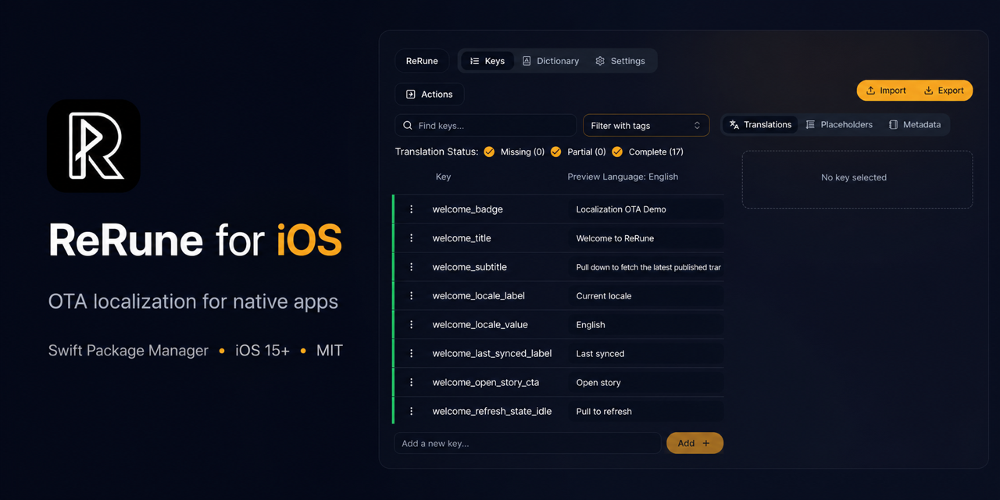

# ReRune for iOS

ReRune is an over-the-air localization SDK for iOS. Ship translation updates
and dashboard-managed app languages without waiting for another App Store
release, while keeping native `NSLocalizedString` and SwiftUI integration.

[Start for free](https://rerune.io/register) ·
[Website](https://rerune.io) ·
[Releases](https://github.com/BasalBit/rerune-ios/releases)




## Why ReRune?

- **Release-independent copy:** publish approved translation updates without
  waiting for another App Store release.
- **Runtime language expansion:** add dashboard-managed app languages after the
  application has shipped.
- **Native integration:** keep `NSLocalizedString`, UIKit, and SwiftUI revision
  observation instead of replacing the application's localization layer.

`ReRune dashboard → OTA publish → ReRune iOS SDK → native app localization`

## Install (SPM)

Requires iOS 15 or later.

Add this package dependency in Xcode:

```text
https://github.com/BasalBit/rerune-ios.git
```

Then import:

```swift
import ReRune
```

## Remote languages without an app release

ReRune can make dashboard-only languages available even when the app bundle shipped with only English resources. For example, if the app has only `en` bundled strings and the ReRune dashboard later publishes German (`de`), the SDK fetches the German manifest entry and locale payload in the background, caches it, and exposes `de` through `reRuneAvailableLocales`.

When German is selected with `reRuneSetLocale("de")`, or when German is the user's platform-preferred language, `NSLocalizedString(...)` calls can render the dashboard-delivered German strings after the first successful fetch. On the next launch, `reRuneSetup(...)` restores the cached manifest and German strings before the UI is shown, so the same language can render immediately without a compiled `de.lproj`.

Lookup walks the current language from most to least specific, then the manifest's `main_language`, and tries each step OTA first and then in the app's bundled strings. For `de-AT` with main language `en`: OTA `de-AT`, bundled `de-AT`, OTA `de`, bundled `de`, OTA `en`, bundled `en`. The current language is the one passed to `reRuneSetLocale`, or the phone language when none is set. The backend owns this fallback; applications do not need another setup parameter. Cached manifests restore the same fallback synchronously on later launches.

This runtime language expansion is app-level. iOS Settings language lists, App Store language metadata, native system strings, and new string keys still require an app release.

## UIKit quick start

```swift
import ReRune

reRuneSetup(otaPublishId: "replace-with-ota-publish-id")

titleLabel.text = NSLocalizedString("title", comment: "")

reRuneRevisionPublisher
    .dropFirst()
    .sink { [weak self] _ in self?.rebindStrings() }
    .store(in: &cancellables)
```

Rebinding on `reRuneRevisionPublisher` is the supported UIKit pattern on every
iOS version. On iOS 26, UIKit also refreshes strings that you look up in
`viewWillLayoutSubviews`, because it tracks the lookup like an observed value.

## SwiftUI quick start

```swift
import SwiftUI
import ReRune

@main
struct ExampleApp: App {
    init() {
        reRuneSetup(otaPublishId: "replace-with-ota-publish-id")
    }

    var body: some Scene {
        WindowGroup {
            ContentView()
        }
    }
}
```

```swift
import SwiftUI

struct ContentView: View {
    var body: some View {
        Text(NSLocalizedString("title", comment: ""))
    }
}
```

On iOS 17 and later, views that look up strings in their `body` refresh
automatically when ReRune applies new translations. Strings resolved outside
`body`, for example in an initializer or a view model, do not.

On iOS 15 and 16, apply `reRuneObserveRevision()` once near the root of the
screens that show ReRune strings. It rebuilds that subtree when translations
change, which also resets its view state, such as scroll positions and text
input. On iOS 17 and later it changes nothing.

```swift
WindowGroup {
    ContentView()
        .reRuneObserveRevision()
}
```

## Logging

SDK diagnostics are disabled by default. Opt in during setup only when needed:

```swift
reRuneSetup(
    otaPublishId: "replace-with-ota-publish-id",
    logLevel: .info
)
```

| Level | Behavior |
| --- | --- |
| `.off` | Default. Emits no SDK diagnostics. |
| `.error` | High-level failures and warnings about rejected remote values, without causes or sensitive request/response details. |
| `.info` | Adds operation names, sanitized request method/URL, synchronization decisions, and response status codes. |
| `.verbose` | Adds full request URLs, headers, bodies, failure causes, and stack traces. |

Levels are cumulative and every message starts with `ReRune:`. Use `.verbose` only as an explicit sensitive-data diagnostic mode: it may expose credentials and translation content. Headers, bodies, credentials, causes, and stack traces are never logged below `.verbose`. The OTA publish ID is not a secret: from `.info`, logged request URLs show it as part of the URL path.

When ReRune rejects a locale because of an incompatible remote value, it logs one warning per key and one for the locale from `.error`:

```text
ReRune: Warning: Locale de rejected the remote value for key "items_count" because it reads format arguments that the value shipped in the app does not pass.
ReRune: Warning: Locale de was not applied because 1 remote value is incompatible. Lookup keeps the previously applied values for this locale, or falls back to the next available value.
```

## Runtime language picker

After setup, apps can show the union of compiled bundle locales and ReRune dashboard locales:

```swift
let locales = reRuneAvailableLocales
let localeDetails = reRuneAvailableLocaleDetails
```

`reRuneAvailableLocalesPublisher` emits identifier-list changes.
`reRuneAvailableLocaleDetailsPublisher` also emits manifest display-name
changes. To switch the SDK runtime language from an in-app picker:

```swift
reRuneSetLocale("de")
```

Pass `nil` to follow the system preferred language again:

```swift
reRuneSetLocale(nil)
```

The current app-level override is available as `reRuneSelectedLocale`. Persist picker choices in app storage and reapply them after `reRuneSetup(...)` if the selected language should survive app restarts.

For example:

```swift
private let localeStorageKey = "selectedLocale"

func configureLocalization() {
    reRuneSetup(otaPublishId: "replace-with-ota-publish-id")
    reRuneSetLocale(UserDefaults.standard.string(forKey: localeStorageKey))
}

func selectLocale(_ locale: String?) {
    UserDefaults.standard.set(locale, forKey: localeStorageKey)
    reRuneSetLocale(locale)
}
```

The picker can render `reRuneAvailableLocaleDetails`; each `ReRuneLocale`
contains an `identifier` and nullable manifest-provided `name`. Compiled-only
locales use their identifier as the name. The existing
`reRuneAvailableLocales` API remains available when only identifiers are needed.

```swift
ForEach(reRuneAvailableLocaleDetails, id: \.identifier) { locale in
    Text(locale.name ?? locale.identifier)
}
```

After a dashboard-only locale is successfully applied, both lists can include
it even when it was not compiled into the app bundle.

## Translation variants

Use [Translation Variants](https://rerune.io/translation-variants) when the same
product action needs different wording for a customer, white-label brand, plan,
role, region, experiment, or partner. The app keeps one translation key. Main
holds the shared content, and each named Variant overrides only the keys and
languages that differ.

Variants solve an audience problem. Use locales for language differences and
plural forms for quantity-dependent grammar. A Variant can contain plain or
supported plural content, and a missing Variant value falls back to Main for
the same key and language.

Each project Variant has a stable runtime value. Select one during setup when
the audience is already known:

```swift
reRuneSetup(
    otaPublishId: "replace-with-ota-publish-id",
    variant: ReRuneVariant("customer_acme")
)
```

Or select it after login, once the app knows the customer, brand, plan, or role:

```swift
try await reRuneSetVariant(ReRuneVariant("customer_acme"))
```

The setter changes subsequent native Foundation lookups before it returns and
emits through `reRuneRevisionPublisher`. Pass `persist: true` to restore the
selection during later `reRuneSetup(...)` calls:

```swift
try await reRuneSetVariant(
    ReRuneVariant("customer_acme"),
    persist: true
)

try await reRuneResetVariant() // Select and store Main.
```

Without persistence, `.main` or a named Variant applies only to the current
runtime. A stored selection takes precedence over a later setup argument. The
SDK does not fetch the project Variant catalog, so the application selects the
published runtime value using context it already owns.

Dashboard publishing includes Main and its alternatives for SDK delivery.
Platform imports and exports currently contain Main translations only.

## Plural strings

Dashboard plural updates use the same native lookup and formatting calls as bundled `.stringsdict` plurals:

```swift
let format = NSLocalizedString("item_count", comment: "")
let text = String.localizedStringWithFormat(format, count)
```

ReRune derives native cardinal plurals from the backend's generic structured
message records. Current payloads use the key's placeholder catalog for both the
plural control and displayed arguments. Legacy payloads without a declared
control placeholder retain their first implicit control argument.

A declared control such as `count` selects the plural category. The declaration
does not add visible text by itself. It appears in the result only when a form
also references `{{count}}` or contains an argument part named `count`.

For example, a message controlled by `count` that displays `firstName` and
`itemCount` keeps the normal Foundation call:

```swift
let format = NSLocalizedString("inventory_summary", comment: "")
let text = String.localizedStringWithFormat(
    format,
    count,
    firstName,
    itemCount
)
```

Malformed or unsupported rendering records reject that locale update and keep
the previously applied or bundled localization.

Foundation chooses the plural category using the device's current formatting locale. When `reRuneSetLocale(_:)` selects a language whose plural rules differ from the device locale, ReRune selects that language's OTA text but Foundation still chooses its category using the device locale.

## Notes

- SDK installs a targeted `Bundle.main` localization override so UIKit and Foundation code can keep using native lookup APIs.
- API auth is `otaPublishId` only.
- Manifest endpoint is fixed by SDK and has no platform query parameter.
- Manifest parsing is strict: root and locale `version` values are non-negative JSON integers; `locales` is keyed; `main_language` is required; and every locale has an absolute `url`.
- Manifest locale keys and `main_language` must use `language[-Script][-REGION]`, where language is 2 to 3 ASCII letters, script is 4 ASCII letters, and region is either 2 ASCII letters or 3 digits. `_` separators and surrounding whitespace are normalized.
- Every manifest locale requires a non-negative `minimum_delta_base_version`. Exact version/minimum matches skip that locale. A missing cache record or minimum change requests the manifest locale URL unchanged as a full replacement (for example `.../sq/88.json`); otherwise changed versions request a delta by prepending the stored successful version and `..` to the file name (for example `.../sq/86..88.json`).
- Locale `409` responses and manifests whose locale target is behind the stored successful version are treated as stale-manifest signals. ReRune retries the complete synchronization once after fetching the manifest without `If-None-Match`, then returns `.failed` if the refreshed state is still stale.
- ETag revalidation applies only to the manifest. Locale requests never send `If-None-Match`, and a locale `304` is treated as an unsupported per-locale failure that preserves cached state.
- `main_language` must normalize to a locale declared in the same manifest. Manifests without it are rejected; an invalid cached manifest and its locale bundles are purged during setup.
- Each locale URL returns a top-level array of locale-scoped generic translation
  records. Object and array nodes can contain children under `translationKeys`.
  Every node has a `values` array containing zero or one entry, and only
  `type: "key"` nodes contribute runtime translations.
  `values: []` is preserved in cache but supplies no runtime override, so lookup
  continues through the main-language and bundled fallback chain. Plain
  `value` messages and structured messages are supported when one entry is
  present.
- A localized value can contain an optional `variations` array sorted by exact
  lowercase slug. ReRune selects at most one matching item. A missing list or
  match uses the localized value's Main `value` or `message`.
- A delta record with `values: []` replaces the cached record and removes any
  previous runtime override for that key. Records omitted from a delta retain
  their cached state. A one-entry record with `value: ""` remains an intentional
  empty translation and does not fall back.
- Placeholder tokens use `{{name}}`. Names are case-sensitive; `string` and
  `int` declaration types are case-insensitive; multiple placeholders are
  supported.
- ReRune compares each remote value with the value your app ships for the same
  key. A remote value that reads a format argument your shipped value does not
  read, or reads it with a different kind, rejects the whole locale update.
  This keeps a dashboard edit from changing the arguments your
  `String(format:)` calls pass. Keys your app does not ship are not checked.
  When the shipped value is a format string, literal percent signs in remote
  text are escaped.
- A visible token without an exact matching declaration also rejects the whole
  locale update.
- A rejected locale keeps its previously applied values, or lookup continues
  with the next step of the lookup order. Nothing is thrown to your
  app. Each rejected key and the rejected locale are logged as warnings from
  the `.error` log level.
- Malformed declarations, token syntax, or rendering structures also reject
  the locale atomically. Unknown non-rendering fields are preserved and
  ignored at runtime.
- Dashboard-only locales appear in `reRuneAvailableLocales` only after their locale payload and manifest metadata are successfully committed, or on startup when a valid applied-locale cache record restores them.
- Each successful locale commit stores the manifest entry's `name`, `url`, `version`, and `minimum_delta_base_version` with a complete canonical generic JSON snapshot. A failed locale retains its previous applied metadata; the cached raw manifest remains only the transport snapshot used for later retries.
- This breaking cache schema uses a new namespace. Legacy platform-specific
  cache entries are not read, migrated, or deleted, so the first launch after
  upgrading behaves like a cold OTA cache.
- `reRuneAvailableLocaleDetails` and `reRuneAvailableLocaleDetailsPublisher` expose normalized locale identifiers plus nullable successfully applied manifest names. Equal-version name-only changes are persisted without calling the locale endpoint and publish the manifest revision.
- Runtime lookup uses the selected ReRune locale when set, otherwise the platform preferred language. Missing OTA keys then use the manifest `main_language` OTA chain before bundled strings.
- `reRuneSetup(...)` restores and parses the local cache synchronously so cached strings are immediately available. Its startup network check runs in a detached Swift-concurrency task and does not delay setup completion.
- `reRuneRevisionPublisher` is the change notification stream for visible UI refreshes; the emitted value is the latest applied manifest revision and may repeat when OTA payloads change under the same manifest revision.
- Persisted Variant selections are scoped by a digest of `otaPublishId` and
  stored separately from manifest and locale cache cleanup.
- Native OTA override support in phase 1 is limited to `Bundle.main` and the default `Localizable` table.
- SwiftUI `Text("key")`, `LocalizedStringKey`, `LocalizedStringResource`, and `String(localized:)` are not supported for OTA interception in phase 1; use `NSLocalizedString(...)` instead. This also applies to apps that use String Catalogs (`.xcstrings`), whose compiled strings ReRune otherwise overrides and checks like `.strings` files.
- Periodic refresh policy uses split fields: `periodicIntervalInHours` + `periodicIntervalInDays`.
- `checkOnStart` (default `true`) checks for updates when the app opens,
  both on launch and on a return to the foreground, at most once every
  15 minutes after a successful check. A failed check is retried on the next
  open after one minute. `false` turns off both.
- A periodic interval also triggers a check on a return to the foreground
  once it has passed, because iOS does not run the timer while the app is
  suspended.
- `reRuneCheckForUpdates()` always checks, regardless of these intervals.

## Example apps

Open `Examples/ReRuneExamples.xcworkspace` to try both demo apps:

- `ReRuneUIKitExample`
- `ReRuneSwiftUIExample`

Both examples use the same demo OTA publish ID, set in each app's `Config/Example.xcconfig`.

They consume ReRune exactly like a customer app: Swift Package Manager resolves the released SDK from this repository with the Up to Next Major Version rule. Open the workspace and Xcode downloads the release; no local SDK checkout is involved.

## License

ReRune is available under the [MIT License](LICENSE).
